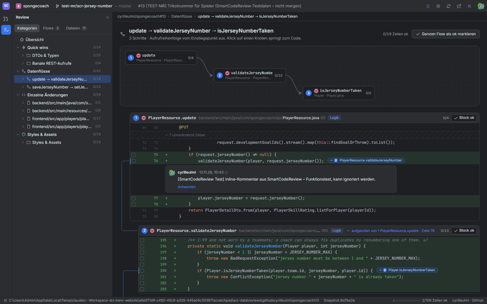
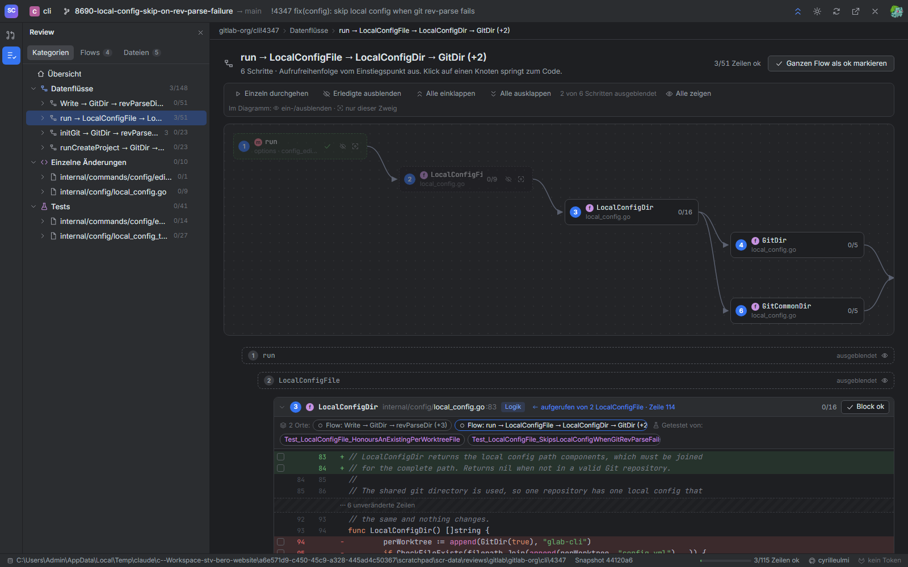

# SmartCodeReview (PoC)

Code-Reviews nach **Bedeutung statt nach Dateien**. SmartCodeReview holt deine offenen Pull Requests von **GitHub** und Merge Requests von **GitLab** (gitlab.com oder self-managed), zerlegt jede Änderung in sinnvolle Einheiten (Funktionen, Typen, Hunks) und sortiert sie:

1. **Quick wins** – höchstwahrscheinlich irrelevante Änderungen (generierter Code, Übersetzungen, DTOs, Mapper, banale REST-Aufrufe, Imports …) zum schnellen Abhaken. Erkannt per Muster, **ohne KI**.
2. **Datenflüsse** – geänderte Funktionen, die sich gegenseitig aufrufen, in Aufrufreihenfolge: Diagramm oben, Code darunter, die Aufrufstellen sind mit dem aufgerufenen Code verbunden. Flüsse gehen auch über REST vom Frontend ins Backend.
3. **Architektur** (bei Ports & Adapters): *Domäne*, *Use Cases*, *Application Layer*, *Adapter*; **Frontend**: *Routing*, *Zustand*, *API-Anbindung*, *Formulare*, *Komponenten-Logik*, *Templates*.
4. **Einzelne Änderungen**, **Tests**, **Styles & Assets**. Jeder geänderte Testfall ist mit dem Code verknüpft, den er (statisch ermittelt) aufruft: welche Komponenten er testet und welche Codestellen er direkt oder indirekt erreicht.

Jede geänderte Zeile kann als **ok** markiert werden, einzeln, als Block, als Gruppe, als Flow oder als ganze Kategorie. Erscheint ein Block an **mehreren Orten** (z. B. als Quick win und in einem Flow, oder in zwei Flows), braucht er an jedem Ort ein eigenes Ok; die Dateiansicht zeigt das pro Zeile und springt zu den Orten. Die Markierungen leben **nur lokal** in JSON-Dateien, die auch Agenten lesen und schreiben können. Kommentare gehen **sofort** als Inline-Kommentare an GitHub bzw. GitLab.



## Schnellstart (lokal)

Voraussetzungen: JDK 21+ (getestet mit 25), Node 22+ und mindestens ein Code-Host:

| Host | Zugang | Ohne Token |
|---|---|---|
| GitHub | `GITHUB_TOKEN` / `GH_TOKEN`, sonst `gh auth token` | – |
| GitLab | `GITLAB_TOKEN` / `GL_TOKEN` (Scope `api`), sonst `glab config get token`; self-managed: `SCR_GITLAB_URL=https://gitlab.example.com` | Öffentliche Merge Requests lassen sich per URL öffnen (nur lesen) |

```powershell
# Windows
./start.ps1
```

```bash
# macOS / Linux
./start.sh
```

Das Skript baut beim ersten Mal das Angular-UI und startet dann Quarkus im Dev-Mode. Danach im Browser **http://localhost:8080** öffnen.

Beliebige PRs/MRs (auch fremde, öffentliche) öffnest du, indem du die URL ins Suchfeld der PR-Liste einfügst und Enter drückst.

### Fertiges Image von Docker Hub

```powershell
docker run --rm -p 127.0.0.1:8080:8080 -v ${PWD}/data:/data `
  -e GITHUB_TOKEN=$(gh auth token) -e GITLAB_TOKEN=glpat-... culmi/smart-code-review:latest
```

Natives Executable (Mandrel, linux/amd64), Image ca. 120 MB, Start in ca. 50 ms. Alle Tokens sind optional.

### Native-Binary selbst bauen (Docker)

```powershell
$env:GITHUB_TOKEN = gh auth token      # optional
$env:GITLAB_TOKEN = "glpat-..."         # optional
docker compose up --build
```

Der Build kompiliert Backend und UI im Container zu einem nativen Executable (Mandrel). Ein lokales GraalVM braucht es nicht. Die Daten liegen dann in `./data`.

### UI-Entwicklung mit Hot Reload

```bash
cd backend && ./mvnw quarkus:dev      # API auf :8080
cd frontend && npm start              # UI auf :4200, /api wird an :8080 weitergeleitet
```

## Bedienung

| Was | Wie |
|---|---|
| PR/MR öffnen | Tool-Fenster «Pull/Merge Requests» (Alt+1), Filter *Alle / Von mir / Review*, oder URL einfügen + Enter |
| Navigieren | Tool-Fenster «Review» (Alt+2): Tabs *Kategorien / Flows / Dateien* |
| Zeile ok | Häkchen im Gutter; **Shift-Klick** markiert einen Bereich |
| Block / Gruppe / Flow ok | Button «Block ok», ✓-Button im Baum (beim Überfahren), «Ganzen Flow als ok markieren» |
| Kommentar | Sprechblase im Gutter (nur auf Zeilen im Diff), Ctrl+Enter sendet sofort an GitHub/GitLab |
| Aufruf folgen | Farbige Chips `→ ② saveEvent` an der Aufrufstelle, «← aufgerufen von …» im Block-Kopf; jede Verbindung hat ihre Farbe (gleich im Diagramm und in der Linie links) |
| Schichten erkennen | Farbiger Streifen + Badge an jedem Block und Knoten: Frontend (cyan), API/Adapter ein (orange), Use Case (violett), Application (blau), Domäne (grün), Daten/Adapter aus (gelb), Test (rosa); dazu die Sprache (TS, Java, …) |
| Erledigtes ausblenden | Toolbar-Knopf (Pfeile): vollständig markierte Blöcke einklappen |
| Fokussieren | Blocktitel anklicken = ein-/ausklappen; Leiste über jeder Liste: *Einzeln durchgehen* (ein Block nach dem anderen, «Ok & weiter»), *Alle ein-/ausklappen*; im Flow zusätzlich *Erledigte ausblenden* und pro Knoten 👁 ein-/ausblenden bzw. ⌖ «nur dieser Zweig» |
| Kategorien | Schalter auf jeder Kategorie-Karte der Übersicht (bzw. Auge im Review-Baum): ausgeschaltete Kategorien sind ausgeblendet und brauchen kein Ok |
| Komponenten | Übersicht → *Komponenten*: Diagramm aller geänderten Komponenten nach Schicht; ⌖ zeigt nur eine Komponente und ihre Abhängigkeiten |
| Mehrere Orte | Leiste «n Orte» im Block-Kopf (✓ = dort ok, Klick springt hin); in der Dateiansicht kleine Zahl am Häkchen, halb gefülltes Häkchen = an einem Teil der Orte ok |
| Tests | Kategorie *Tests*: Testübersicht mit Komponenten und abgedeckten Codestellen; im Code-Block «Getestet von …» bzw. «Testet …» |
| Commits | Review-Fenster → *Commits* oder Übersicht: Klick auf einen Commit zeigt in allen Ansichten nur seine Änderungen (Änderungen anderer Commits abgeblendet), Häkchen gelten dann nur für seine Zeilen; ✓ markiert den ganzen Commit. In der Toolbar ← → zum vorherigen/nächsten Commit, × zeigt wieder alles |
| Annotieren (Blame) | Toolbar-Knopf (Zeilen-Symbol): Spalte mit Datum, Autor und Nummer des PR-Commits pro Zeile, wie «Annotate with Git Blame» in IntelliJ; gelöschte Zeilen zeigen den Commit, der sie entfernt hat. Klick filtert auf diesen Commit bzw. öffnet ältere Commits auf GitHub/GitLab |



## Dokumentation

| Dokument | Inhalt |
|---|---|
| [docs/01-konzept.md](docs/01-konzept.md) | Anforderungen und Entscheide aus dem Kick-off |
| [docs/02-annahmen.md](docs/02-annahmen.md) | Annahmen und bewusste Vereinfachungen des PoC |
| [docs/03-architektur.md](docs/03-architektur.md) | Aufbau, REST-API, Technologie |
| [docs/04-persistenz-und-agenten.md](docs/04-persistenz-und-agenten.md) | Dateiformat im Datenverzeichnis, Zusammenarbeit mit Agenten |
| [docs/05-analyse.md](docs/05-analyse.md) | Wie Quick wins und Datenflüsse ohne KI erkannt werden; `rules.json` |
| [docs/06-test-prs.md](docs/06-test-prs.md) | Die Test-PRs in den anderen Repos und was dabei herauskommen sollte |
| [docs/07-roadmap.md](docs/07-roadmap.md) | Nächste Schritte |
| [docs/08-versionierung.md](docs/08-versionierung.md) | Versionsschema, Release mit `./release.sh X.Y.Z`, Docker-Tags |
| [CHANGELOG.md](CHANGELOG.md) | Änderungen pro Version |

## Projektstruktur

```
backend/    Quarkus 3.40 (Java 25): GitHub-/GitLab-Anbindung, Analyse, Datenablage, REST-API, liefert das UI aus
frontend/   Angular 22 (standalone, signals, zoneless): UI im IntelliJ-«New UI»-Look
docs/       Konzept, Annahmen, Architektur, Formate
Dockerfile  Native-Build (Node → Mandrel → ubi9-micro)
```
