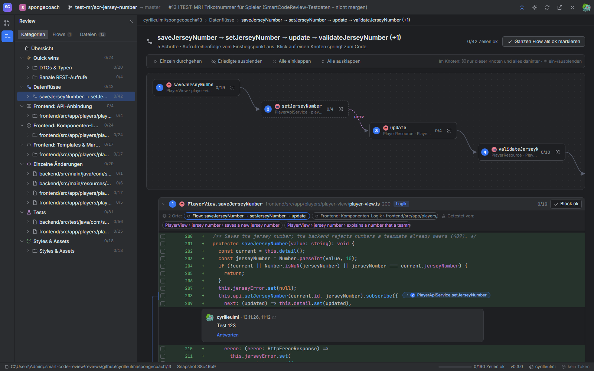
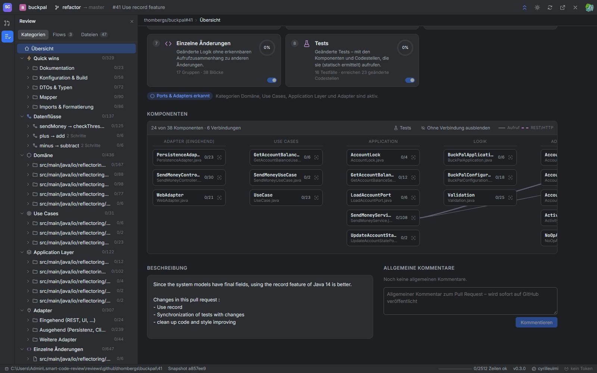

# Analyse ohne KI

Die gesamte Einteilung ist deterministisch: gleicher PR + gleiche Regeln = gleiches Ergebnis. Grundlage sind der Diff von GitHub und der Quelltext der neuen Dateiversion.

## 1. Segmente bilden

Für jede geänderte Datei:

1. **Pfad-Regel passt** (z. B. `**/package-lock.json`, `**/i18n/**`) → jede Hunk wird ein Segment dieser Kategorie. Fertig. Ausnahme: Regeln mit `"symbols": true` (die Test-Regel) zerlegen die Datei trotzdem wie in Punkt 2, damit jeder Testfall ein eigenes Segment ist.
2. **Sprache mit Struktur** (TS/JS/Java/Kotlin/C#/Go) und Quelltext vorhanden → `SymbolExtractor` findet Funktionen, Methoden, Klassen, Interfaces, Typen, Enums und Top-Level-Konstanten mit Zeilenbereich (Kommentare und Annotationen direkt darüber gehören dazu). Jede geänderte Zeile kommt in das **innerste** Symbol, das sie enthält. Leere Zeilen schliessen sich dem Nachbarn an. Zeilen ausserhalb aller Symbole (Imports, Modul-Code) bilden pro Hunk ein «Modul»-Segment.
3. **Sonst** (HTML, SQL, gelöschte Dateien …) → ein Segment pro Hunk.

Callbacks in Objekt-Literalen innerhalb von Funktionen (`subscribe({ next: … })`) werden **nicht** als eigene Symbole behandelt, damit eine Methode nicht zerstückelt wird. Ebenso Hilfsfunktionen innerhalb eines Testfalls.

**Testfälle** sind eigene Symbolarten: `test` (`it('…')`, `test('…')`, `@Test`-Methoden, Go `TestXxx`), `suite` (`describe('…')`) und `setup` (`beforeEach` & Co.). Ihr Name ist die Beschreibung, mit den umgebenden `describe`-Blöcken: `PlayerView › jersey number › saves a new jersey number`.

## 2. Quick wins erkennen

Segmente ohne Pfad-Regel werden gegen die **Segment-Regeln** geprüft (erste passende gewinnt):

| Regel | Erkennt | Prinzip |
|---|---|---|
| `imports` | Imports & Formatierung | Alle geänderten Zeilen sind Import-/Export-Zeilen |
| `formatting` | Imports & Formatierung | Hinzugefügte und gelöschte Zeilen sind ohne Leerraum identisch (umformatiert / verschoben) |
| `jpa-repositories` | → Datenbank & Migrationen | Datei enthält `interface … extends …Repository` oder `@Query(` (`fileText`) |
| `jpa-entities` | → Datenbank & Migrationen | Datei enthält `@Entity`, `@Embeddable` oder `@MappedSuperclass` |
| `type-symbols` | DTOs & Typen | Segment ist ein `interface`, `type` oder `enum` |
| `mapper-code` | Mapper | Funktionsname wie `map…`, `to…`, `from…`, `convert…` **und** alle Zeilen sind Feldzuweisungen |
| `rest-trivial` | Banale REST-Aufrufe | Alle Zeilen sind Signatur / `http.get(...)` / `fetch(...)` / Header / `return service.x(...)`, mindestens ein echter HTTP-Aufruf |
| `type-declarations` | DTOs & Typen | Alle Zeilen sind Feld-/Typdeklarationen (`name?: string;`, `private String name;`, Annotationen) |
| `declarative-config` | Deklarative Felder & Konfiguration | Alle Zeilen sind Objekt-Literale mit festen Werten (`{ name: 'title', type: 'text' }`) |
| `logging` | Logging | Nur `console.log`/`log.info(…)` |

«Alle Zeilen» ignoriert immer Leerzeilen, reine Klammerzeilen und Kommentare.

Die Pfad-Regeln (Auszug): generierte Dateien und Lockfiles (auch `gen/`, `dist/`, `build/generated/`), Übersetzungen (`i18n/`, `locales/`, `*.po`, `messages*.properties` …), Dokumentation (`*.md`), Werkzeug-Konfiguration (`tsconfig*.json`, Linter, generische `*.yml`), DTO-Dateien (`*Dto.*`, `dto/`, `*.model.ts`, `types.ts`), Mapper-Dateien (`*Mapper.*`), Tests, Styles & Assets. Keine Quick wins, sondern eigene Kategorien: Migrationen (*Datenbank & Migrationen*), API-Verträge (`openapi*.yaml` …), Laufzeit-Konfiguration, Deployment/CI und Abhängigkeiten (*Konfiguration, Build & Betrieb*).

## 3. Aufrufe und Flüsse

1. **Kanten:** Für jede geänderte Funktion A wird ihr Rumpf (ohne Imports, ohne darin verschachtelte geänderte Funktionen) nach den Namen der anderen geänderten Funktionen/Konstanten B durchsucht. Kurze oder generische Namen (`get`, `save`, `map` …) zählen nur mit Aufrufsyntax `name(`. Über Dateigrenzen braucht es einen Import-Beleg (Modulpfad, Klassen- oder Funktionsname im Import; Java: Klassenname im Code). Ausnahme: klassische Skripte ohne Module teilen sich den globalen Scope.
   Go: Dateien im selben Ordner sind ein Paket und brauchen keinen Import. Tests rufen Produktivcode auf, aber nie umgekehrt.
2. **Hubs** (mehr als 5 Aufrufer) werden für den Zusammenhang ignoriert, damit `cn()` oder `Button` nicht alles zu einem Fluss verkleben. Kanten von Tests zählen dabei nicht.
3. **Flüsse:** Jeder Einstiegspunkt (geänderte Funktion ohne geänderten Aufrufer) bekommt einen eigenen Flow mit allem, was er erreicht – mindestens zwei Segmente, davon mindestens eines Logik. Eine gemeinsam genutzte Funktion ist deshalb Teil **mehrerer** Flows. Ausnahme: In zusammenhängenden Gruppen mit mehr als 20 Funktionen kommt jede Funktion nur im ersten Flow vor, der sie erreicht (sonst würden riesige PRs mit Duplikaten geflutet). Tests werden nie Teil eines Flows.
4. **Reihenfolge:** Tiefensuche ab dem Einstiegspunkt (kein Aufrufer im Flow; äussere Schicht zuerst), Aufrufe in Reihenfolge ihrer Zeile. Daraus entstehen Schrittnummer und Tiefe für Diagramm und Einrückung.
5. **Titel:** Kette der ersten Schritte, z. B. `update → validateJerseyNumber → isJerseyNumberTaken`. Beginnt der Flow an einem Endpunkt oder Listener, steht der Auslöser davor: `PUT /rest/players/{}: updatePlayer → …`, `JMS-Listener: onMessage → readEvent → applyEvent`.

## 3b. Über REST ins Backend

Für jedes Segment werden HTTP-Aufrufe mit literaler URL gesucht (`this.http.put<T>(`/api/players/${id}`, …)`, `fetch('/api/x', { method: 'POST' })`, `axios.get(…)`), für jede Methode die Endpunkte (`@Path("/api/players")` an der Klasse + `@PUT @Path("/{playerId}")` an der Methode, `@GetMapping`, Next.js `app/api/…/route.ts` mit `export async function PUT`, `app.put('/x', …)`, `HandleFunc("PUT /x", …)`). Passen Methode und Pfad (Parameter = Platzhalter), entsteht eine Kante der Art `http`. Damit läuft ein Flow z. B. so: `PlayerView.saveJerseyNumber → PlayerApiService.setJerseyNumber ⇢ PUT /api/players/{} ⇢ PlayerResource.update → validateJerseyNumber → Player.isJerseyNumberTaken`.

**Generierte Clients (OpenAPI):** Ruft das Frontend einen generierten Service auf (`this.playersService.updatePlayer(id, body)`), steht keine URL im Code. Dafür liest die Analyse die Verträge des Repos (`openapi*.yaml`, `swagger.json` …) und kennt jede Operation mit operationId, Methode und Pfad (inkl. `servers: - url: /rest`). Ein Aufruf `.updatePlayer(` wird so zu `PUT /rest/players/{}`; das Gegenstück ist eine Methode `updatePlayer` in einer Klasse, die das generierte Interface implementiert (`class PlayerController implements PlayersApi`), oder ein Spring-/JAX-RS-Endpunkt mit passendem Pfad. Die Kante heisst dann `PUT /rest/players/{} (updatePlayer)`. Geänderte Zeilen im Vertrag (Kategorie *API-Verträge*) verweisen auf die geänderten Aufrufer und Implementierungen derselben Operation.



## 3c. Architektur und Frontend

* **Ports & Adapters:** Die Ordner des ganzen Repos werden einmal geladen (`structure.json`). Gibt es Rand- und Kern-Ordner (siehe Annahme B14), bekommt jedes Code-Segment eine Schicht und erscheint zusätzlich in *Domäne*, *Use Cases*, *Application Layer* oder *Adapter* (eingehend / ausgehend / weitere).
* **Frontend:** Segmente in Frontend-Dateien werden gegen die `aspects`-Regeln geprüft (erste passende): Routing, Zustand, API-Anbindung, Formulare, Komponenten-Logik, Templates. Bedingungen: `paths`, `kinds`, `symbol`, `text` (Muster im Code des Segments), `fileText` (Muster irgendwo in der Datei), `special: "markup"` (mehrheitlich HTML/JSX-Zeilen).
* **Schichten mit Adaptern (Onion-Stil):** Hat das Repo `domain`, `application` und `adapter`, aber keine Ports/Use Cases, heisst der Stil `layered`. Die Kategorien sind dieselben; Adapter werden nach Rolle gruppiert (eingehend inkl. Message-Listener, ausgehend, Mapping, Konfiguration).
* **Querschnitt (`concerns`):** Sicherheit & Berechtigungen, Messaging & Events, Transaktionen & Nebenläufigkeit, Datenbank & Migrationen – für Frontend und Backend, **alle** passenden Regeln zählen. Funktionen werden mit ihren Annotationen geprüft (`@Transactional`, `@JmsListener`, `@PreAuthorize` …), Konfigurationsdateien zeilenweise (`spring.jms…`, `…cors…`, `ddl-auto`).
* **Schema:** Migrationen und Entities, die dieselbe Tabelle nennen, stehen in *Datenbank & Migrationen* in der Gruppe «Tabelle x» und verweisen aufeinander.
* Alles das sind **zusätzliche Orte** mit eigenem Ok. Regeln mit `"extras": false` (Generiert, Imports, Tests, Styles …) bekommen keine.

## 3d. Komponenten

Geänderte Code-Dateien gleichen Namens im gleichen Ordner bilden eine Komponente (`player-view.ts/.html/.scss`). Jede bekommt eine Spalte (Frontend, Adapter ein, API, Use Cases, Application, Logik, Adapter aus, Daten, Domäne, Tests); die Aufruf- und REST-Kanten zwischen ihren Segmenten werden zu `componentEdges` zusammengefasst. Die Übersicht zeigt daraus das Komponentendiagramm.



## 3e. Kategorien als Module

Jede Kategorie ist ein eigenes **Modul** (`CategoryModule`) mit derselben Schnittstelle:

| Methode | Zweck |
|---|---|
| `id()`, `info()` | Name, Icon und **Selbstbeschreibung**: `summary` (wofür), `builds` (wie sie aufgebaut ist: welcher Code hier landet und warum), `divides` (wie sie in Gruppen unterteilt wird). Das UI zeigt `builds`/`divides` unter dem Titel der Kategorie («Wie entsteht diese Kategorie?») und als Tooltip in der Übersicht. |
| `groups(context)` | Die Gruppen der Kategorie, berechnet aus `SegmentFacts` (Pfad, Regel-Kategorie und -Gruppe, Schicht, Frontend-Aspekt, Querschnittsthemen, Adapter-Richtung, «Teil eines Flusses») und den Flüssen. |
| `view()` | `groups` (Standard: Liste von Gruppen mit Code-Blöcken) oder eine **Ausnahme mit eigener Ansicht**: `flow` (Aufrufdiagramm, Blöcke in Aufrufreihenfolge). Das UI entscheidet danach, nicht nach der Kategorie-Id. |
| `origin()` | `builtin` (fest eingebaut, z. B. Datenflüsse), `rules` (aus der Regeldatei); später `external`. |

**Entkoppelt:** Ein Modul kennt kein anderes Modul und den `Analyzer` nicht. Hinzufügen oder Entfernen einer Kategorie ändert nur ihre eigene Liste; ein Segment, das mehrere Module beanspruchen, wird einfach in jedem zu einem eigenen Ort (Abschnitt 4). Die Module werden aus den Kategorien der Regeldatei erzeugt (`CategoryModules`): Kategorie mit Regeln → Regel-Gruppen; `domain`/`usecases`/`application`/`adapters` → zusätzlich die Architektur-Schicht; Kategorie mit `aspects` → Frontend-Aspekt; mit `concerns` → Querschnittsthema; `flows` → eine Gruppe pro Fluss mit eigener Ansicht; `logic` → der Rest ausserhalb von Flüssen.

**Beschreibung:** `builds` und `divides` werden aus den Regeln abgeleitet (Regel-Gruppen mit ihrem Grund, Aspekte, Querschnittsthemen), stimmen also auch bei eigenen Regeln. Wer es anders formulieren will, setzt `"builds"` / `"divides"` an der Kategorie in `rules.json`.

**Später von aussen (noch nicht umgesetzt):** Das Modul bekommt nur `SegmentFacts` und liefert nur `Group`s, ohne gemeinsamen Zustand. Damit kann ein Modul von ausserhalb der Anwendung geliefert werden. `CategoryModules.build(rules, additional)` nimmt dafür bereits zusätzliche Module entgegen (Ids dürfen nicht doppelt vergeben werden); Gruppen-Ids beginnen mit `<id>/`. Es gibt noch keine Quelle für solche Module und nichts, das sie lädt.

## 4. Orte

Jede Gruppe, die ein Segment zeigt, ist ein **Ort** (`segments[].places`): die Gruppe seiner Kategorie (ausser Logik, die in einem Flow liegt – die steht nur dort) und jeder Flow, der es enthält. Beispiel: `PlayerApiService.setJerseyNumber` ist ein banaler REST-Aufruf *und* der letzte Schritt von `saveJerseyNumber → setJerseyNumber` → zwei Orte, zwei Oks.

**Eine Zeile an mehreren Orten** (`review/LineAcceptance`, im UI gespiegelt in `acceptance.ts`):

* Jeder Ort braucht sein eigenes Akzeptieren. Eine Zeile ist **akzeptiert**, sobald sie an allen ihren Orten akzeptiert ist.
* Ist sie an einem Ort akzeptiert, gilt sie an jedem anderen Ort als **halb akzeptiert**: Das Häkchen ist halb gefüllt, daneben steht der Hinweis «bereits an anderem Ort akzeptiert» (bei mehreren: «an *n* anderen Orten»; einmal pro zusammenhängendem Lauf solcher Zeilen, nicht auf jeder Zeile), der Tooltip nennt die Orte, ein Klick darauf springt zum ersten. Halb akzeptiert zählt im Fortschritt noch **nicht**; mit einem Klick auf das Häkchen wird sie auch hier akzeptiert.
* Mehrere akzeptierte Orte werden einzeln geführt. Nimmt man an einem Ort das Akzeptieren zurück, bleiben die anderen Orte akzeptiert (auch bei einer sonst überall akzeptierten Zeile).
* Eine Markierung ohne Ort (Dateiansicht, Agenten) oder auf einem Ort, an dem die Zeile nicht vorkommt, gilt für alle Orte auf einmal. Zeilen mit nur einem Ort kennen den Halbzustand nicht.
* Ausgeschaltete Kategorien zählen nicht als Ort. «Halb akzeptiert» ist abgeleitet und steht nicht in `review.json`; das Dateiformat (`ok`, `okAt`) ist unverändert.

## 5. Tests verknüpfen

Für jeden geänderten Testfall wird der Aufruf-Graph ab dem Test durchlaufen (Breitensuche, bis 4 Ebenen):

* Erreicht er eine geänderte Funktion direkt (oder über eine Hilfsfunktion in der Testdatei) → **direkt**, mit der Zeile im Test.
* Von dort aus weiter erreichte geänderte Funktionen → **indirekt**, mit dem Segment, über das sie erreicht werden.
* **Komponenten:** die Datei nach Namenskonvention (`PlayerResourceTest.java` → `PlayerResource.java`, `player-view.spec.ts` → `player-view.ts`; bevorzugt gleiche Sprache) und die Klassen/Dateien des direkt aufgerufenen Codes.

Beispiel spongecoach#13: `PlayerResourceTest › savesJerseyNumber` → `PlayerResource.update` (direkt, Testzeile 28) → `validateJerseyNumber` (über update) → `Player.isJerseyNumberTaken` (über validateJerseyNumber).


## 6. Anzeige

* Symbol-Segmente zeigen die **ganze Funktion** aus der neuen Datei, mit eingewobenen gelöschten Zeilen. Unveränderte Strecken über 2 Zeilen ausserhalb von ±2 Zeilen um Änderungen und Aufrufstellen werden zu «⋯ n unveränderte Zeilen».
* Zeilen anderer Segmente innerhalb des Bereichs (z. B. eine verschachtelte geänderte Funktion) werden **gedimmt** und ohne Häkchen gezeigt.
* Aufrufstellen tragen `refs` → im UI ein Chip, der zum aufgerufenen Block springt; in der Flow-Ansicht zusätzlich eine Verbindungslinie.

## Eigene Regeln

`<data>/rules.json` anlegen (Vorlage: `rules.default.json` daneben). Format:

```json
{
  "categories": [ { "id": "quick-wins", "label": "Quick wins", "icon": "bolt", "description": "…", "builds": "…", "divides": "…" } ],
  "rules": [
    { "id": "our-mappers", "category": "quick-wins", "group": "Mapper", "reason": "Unsere Mapper",
      "paths": ["**/*.mapper.ts"] },
    { "id": "feature-flags", "category": "quick-wins", "group": "Feature-Flags", "reason": "Nur Flag-Umschaltung",
      "lines": ["^\\s*[A-Z_]+:\\s*(true|false),?$"], "require": ["true|false"] },
    { "id": "enums", "category": "quick-wins", "group": "DTOs & Typen", "kinds": ["enum"] }
  ]
}
```

| Feld | Bedeutung |
|---|---|
| `paths` | Globs (`**` über Ordner, `*` innerhalb). Klassifiziert ganze Dateien. |
| `lines` | Regex; **jede** geänderte Zeile muss eines davon ganz erfüllen. |
| `require` | Regex; **mindestens eine** Zeile muss es enthalten. |
| `symbol` | Regex auf den Funktions-/Klassennamen. |
| `kinds` | Symbolarten: `class`, `interface`, `type`, `enum`, `function`, `method`, `component`, `const`, `test`, `suite`, `setup`. |
| `special` | `same-content` = nur umformatiert/verschoben. |
| `symbols` | `true`: Dateien dieser Pfad-Regel trotzdem in Funktionen/Testfälle zerlegen (Default `false`). |
| `extras` | `false`: Segmente dieser Regel bekommen keine Architektur-/Frontend-Kategorie (Default `true`). |
| `text`, `fileText` | (nur `aspects`) Regex im Code des Segments bzw. irgendwo in der Datei. |

Zusätzlich zu `rules` gibt es die Liste **`aspects`** (Frontend-Kategorien, erste passende Regel gewinnt). Die Kategorien `domain`, `usecases`, `application`, `adapters` werden automatisch befüllt, wenn sie in `categories` stehen.

Kategorien: `quick-wins`, `logic` (Default für alles Übrige), `tests`, `styles`. `flows` wird automatisch befüllt. Weitere Kategorien kann man ergänzen; sie erscheinen in der Reihenfolge der Datei. `builds` und `divides` an einer Kategorie sind optional (Beschreibung im UI, sonst aus den Regeln abgeleitet, siehe 3e).
