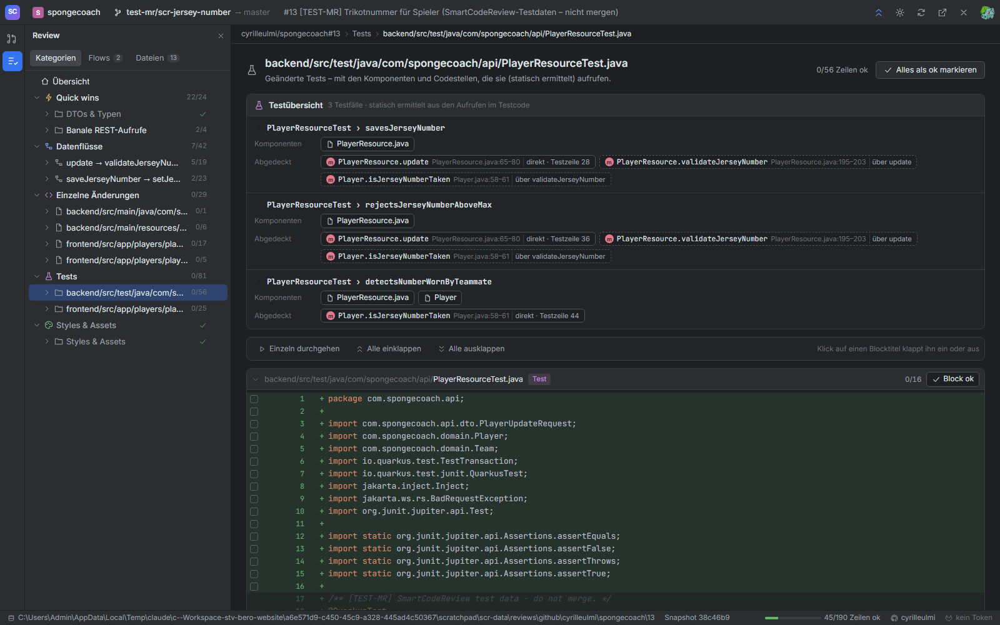
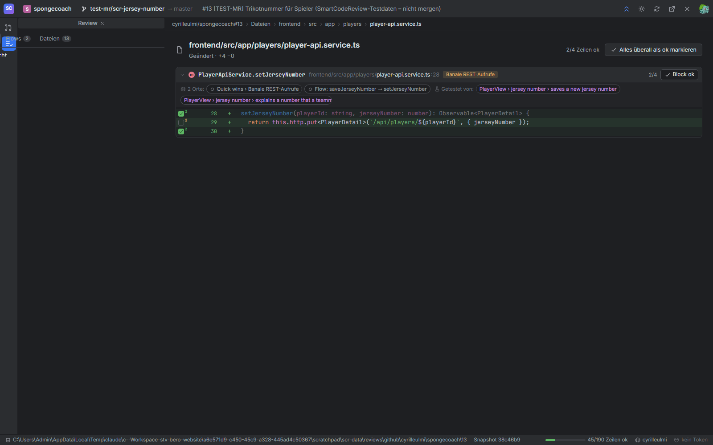

# Analyse ohne KI

Die gesamte Einteilung ist deterministisch: gleicher PR + gleiche Regeln = gleiches Ergebnis. Grundlage sind der Diff von GitHub und der Quelltext der neuen Dateiversion.

## 1. Segmente bilden

Für jede geänderte Datei:

1. **Pfad-Regel passt** (z. B. `**/package-lock.json`, `**/i18n/**`) → jede Hunk wird ein Segment dieser Kategorie. Fertig. Ausnahme: Regeln mit `"symbols": true` (die Test-Regel) zerlegen die Datei trotzdem wie in Punkt 2, damit jeder Testfall ein eigenes Segment ist.
2. **Sprache mit Struktur** (TS/JS/Java/Kotlin/C#/Go) und Quelltext vorhanden → `SymbolExtractor` findet Funktionen, Methoden, Klassen, Interfaces, Typen, Enums und Top-Level-Konstanten mit Zeilenbereich (Kommentare und Annotationen direkt darüber gehören dazu). Jede geänderte Zeile kommt in das **innerste** Symbol, das sie enthält. Leere Zeilen schliessen sich dem Nachbarn an. Zeilen ausserhalb aller Symbole (Imports, Modul-Code) bilden pro Hunk ein «Modul»-Segment.
3. **Sonst** (HTML, SQL, gelöschte Dateien …) → ein Segment pro Hunk.

Callbacks in Objekt-Literalen innerhalb von Funktionen (`subscribe({ next: … })`) werden **nicht** als eigene Symbole behandelt, damit eine Methode nicht zerstückelt wird. Ebenso Hilfsfunktionen innerhalb eines Testfalls.

**Testfälle** sind eigene Symbolarten: `test` (`it('…')`, `test('…')`, `@Test`-Methoden, Go `TestXxx`), `suite` (`describe('…')`) und `setup` (`beforeEach` & Co.). Ihr Name ist die Beschreibung, mit den umgebenden `describe`-Blöcken: `PlayerView › jersey number › saves a new jersey number`.

## 2. Quick wins erkennen

Segmente ohne Pfad-Regel werden gegen die **Segment-Regeln** geprüft (erste passende gewinnt):

| Regel | Erkennt | Prinzip |
|---|---|---|
| `type-symbols` | DTOs & Typen | Segment ist ein `interface`, `type` oder `enum` |
| `imports` | Imports & Formatierung | Alle geänderten Zeilen sind Import-/Export-Zeilen |
| `formatting` | Imports & Formatierung | Hinzugefügte und gelöschte Zeilen sind ohne Leerraum identisch (umformatiert / verschoben) |
| `mapper-code` | Mapper | Funktionsname wie `map…`, `to…`, `from…`, `convert…` **und** alle Zeilen sind Feldzuweisungen |
| `rest-trivial` | Banale REST-Aufrufe | Alle Zeilen sind Signatur / `http.get(...)` / `fetch(...)` / Header / `return service.x(...)`, mindestens ein echter HTTP-Aufruf |
| `type-declarations` | DTOs & Typen | Alle Zeilen sind Feld-/Typdeklarationen (`name?: string;`, `private String name;`, Annotationen) |
| `declarative-config` | Deklarative Felder & Konfiguration | Alle Zeilen sind Objekt-Literale mit festen Werten (`{ name: 'title', type: 'text' }`) |
| `logging` | Logging | Nur `console.log`/`log.info(…)` |

«Alle Zeilen» ignoriert immer Leerzeilen, reine Klammerzeilen und Kommentare.

Die Pfad-Regeln (Auszug): generierte Dateien und Lockfiles, Übersetzungen (`i18n/`, `locales/`, `*.po`, `messages*.properties` …), Dokumentation (`*.md`), Build/Config (`package.json`, `*.yml`, `pom.xml`, `Dockerfile` …), DTO-Dateien (`*Dto.*`, `dto/`, `*.model.ts`, `types.ts`), Mapper-Dateien (`*Mapper.*`), Tests, Styles & Assets.

## 3. Aufrufe und Flüsse

1. **Kanten:** Für jede geänderte Funktion A wird ihr Rumpf (ohne Imports, ohne darin verschachtelte geänderte Funktionen) nach den Namen der anderen geänderten Funktionen/Konstanten B durchsucht. Kurze oder generische Namen (`get`, `save`, `map` …) zählen nur mit Aufrufsyntax `name(`. Über Dateigrenzen braucht es einen Import-Beleg (Modulpfad, Klassen- oder Funktionsname im Import; Java: Klassenname im Code). Ausnahme: klassische Skripte ohne Module teilen sich den globalen Scope.
   Go: Dateien im selben Ordner sind ein Paket und brauchen keinen Import. Tests rufen Produktivcode auf, aber nie umgekehrt.
2. **Hubs** (mehr als 5 Aufrufer) werden für den Zusammenhang ignoriert, damit `cn()` oder `Button` nicht alles zu einem Fluss verkleben. Kanten von Tests zählen dabei nicht.
3. **Flüsse:** Jeder Einstiegspunkt (geänderte Funktion ohne geänderten Aufrufer) bekommt einen eigenen Flow mit allem, was er erreicht – mindestens zwei Segmente, davon mindestens eines Logik. Eine gemeinsam genutzte Funktion ist deshalb Teil **mehrerer** Flows. Ausnahme: In zusammenhängenden Gruppen mit mehr als 20 Funktionen kommt jede Funktion nur im ersten Flow vor, der sie erreicht (sonst würden riesige PRs mit Duplikaten geflutet). Tests werden nie Teil eines Flows.
4. **Reihenfolge:** Tiefensuche ab dem Einstiegspunkt (kein Aufrufer im Flow; äussere Schicht zuerst), Aufrufe in Reihenfolge ihrer Zeile. Daraus entstehen Schrittnummer und Tiefe für Diagramm und Einrückung.
5. **Titel:** Kette der ersten Schritte, z. B. `update → validateJerseyNumber → isJerseyNumberTaken`.

## 4. Orte

Jede Gruppe, die ein Segment zeigt, ist ein **Ort** (`segments[].places`): die Gruppe seiner Kategorie (ausser Logik, die in einem Flow liegt – die steht nur dort) und jeder Flow, der es enthält. Beispiel: `PlayerApiService.setJerseyNumber` ist ein banaler REST-Aufruf *und* der letzte Schritt von `saveJerseyNumber → setJerseyNumber` → zwei Orte, zwei Oks.

## 5. Tests verknüpfen

Für jeden geänderten Testfall wird der Aufruf-Graph ab dem Test durchlaufen (Breitensuche, bis 4 Ebenen):

* Erreicht er eine geänderte Funktion direkt (oder über eine Hilfsfunktion in der Testdatei) → **direkt**, mit der Zeile im Test.
* Von dort aus weiter erreichte geänderte Funktionen → **indirekt**, mit dem Segment, über das sie erreicht werden.
* **Komponenten:** die Datei nach Namenskonvention (`PlayerResourceTest.java` → `PlayerResource.java`, `player-view.spec.ts` → `player-view.ts`; bevorzugt gleiche Sprache) und die Klassen/Dateien des direkt aufgerufenen Codes.

Beispiel spongecoach#13: `PlayerResourceTest › savesJerseyNumber` → `PlayerResource.update` (direkt, Testzeile 28) → `validateJerseyNumber` (über update) → `Player.isJerseyNumberTaken` (über validateJerseyNumber).





## 6. Anzeige

* Symbol-Segmente zeigen die **ganze Funktion** aus der neuen Datei, mit eingewobenen gelöschten Zeilen. Unveränderte Strecken über 2 Zeilen ausserhalb von ±2 Zeilen um Änderungen und Aufrufstellen werden zu «⋯ n unveränderte Zeilen».
* Zeilen anderer Segmente innerhalb des Bereichs (z. B. eine verschachtelte geänderte Funktion) werden **gedimmt** und ohne Häkchen gezeigt.
* Aufrufstellen tragen `refs` → im UI ein Chip, der zum aufgerufenen Block springt; in der Flow-Ansicht zusätzlich eine Verbindungslinie.

## Eigene Regeln

`<data>/rules.json` anlegen (Vorlage: `rules.default.json` daneben). Format:

```json
{
  "categories": [ { "id": "quick-wins", "label": "Quick wins", "icon": "bolt", "description": "…" } ],
  "rules": [
    { "id": "our-mappers", "category": "quick-wins", "group": "Mapper", "reason": "Unsere Mapper",
      "paths": ["**/*.mapper.ts"] },
    { "id": "feature-flags", "category": "quick-wins", "group": "Feature-Flags", "reason": "Nur Flag-Umschaltung",
      "lines": ["^\\s*[A-Z_]+:\\s*(true|false),?$"], "require": ["true|false"] },
    { "id": "enums", "category": "quick-wins", "group": "DTOs & Typen", "kinds": ["enum"] }
  ]
}
```

| Feld | Bedeutung |
|---|---|
| `paths` | Globs (`**` über Ordner, `*` innerhalb). Klassifiziert ganze Dateien. |
| `lines` | Regex; **jede** geänderte Zeile muss eines davon ganz erfüllen. |
| `require` | Regex; **mindestens eine** Zeile muss es enthalten. |
| `symbol` | Regex auf den Funktions-/Klassennamen. |
| `kinds` | Symbolarten: `class`, `interface`, `type`, `enum`, `function`, `method`, `component`, `const`, `test`, `suite`, `setup`. |
| `special` | `same-content` = nur umformatiert/verschoben. |
| `symbols` | `true`: Dateien dieser Pfad-Regel trotzdem in Funktionen/Testfälle zerlegen (Default `false`). |

Kategorien: `quick-wins`, `logic` (Default für alles Übrige), `tests`, `styles`. `flows` wird automatisch befüllt. Weitere Kategorien kann man ergänzen; sie erscheinen in der Reihenfolge der Datei.
