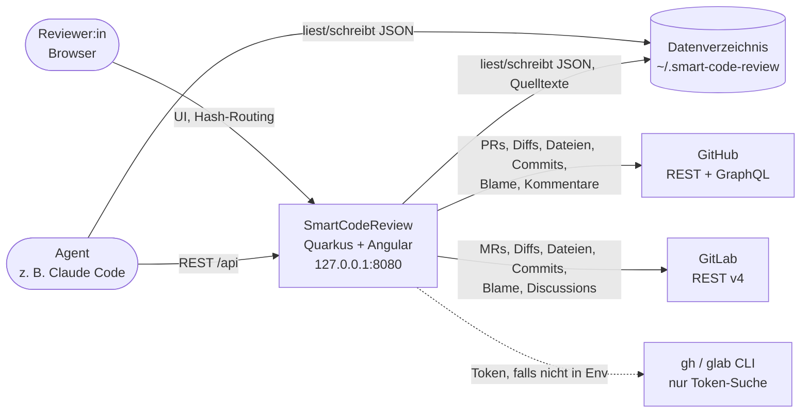
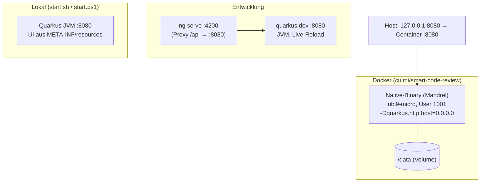
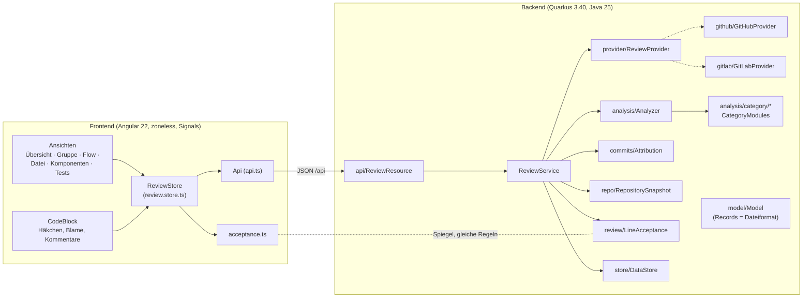
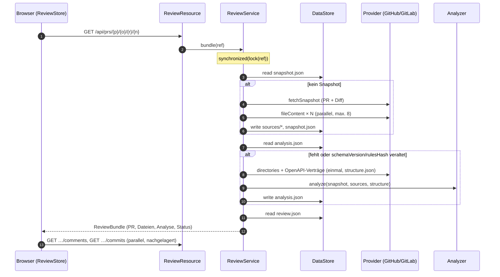
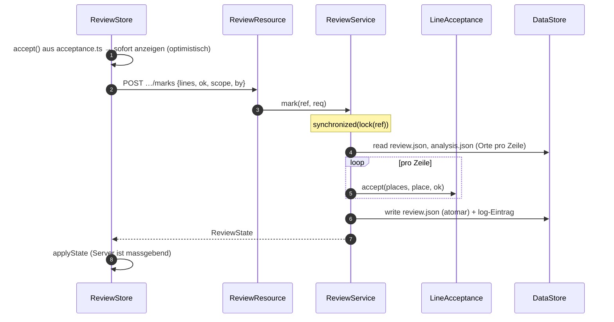
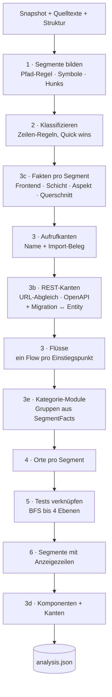

# Architektur-Überblick für Software-Architekt:innen

Dieses Dokument erklärt den Aufbau von SmartCodeReview so, dass man das System beurteilen, erweitern und betreiben kann, ohne zuerst den Code zu lesen. Es folgt grob [arc42](https://arc42.org) und verweist für Details auf die Fachdokumente:

| Wenn du wissen willst … | lies |
|---|---|
| warum es das Tool gibt und welche Begriffe gelten | [01-konzept.md](01-konzept.md) |
| was bewusst vereinfacht ist | [02-annahmen.md](02-annahmen.md) |
| welche Klasse/Datei was tut, REST-API | [03-architektur.md](03-architektur.md) |
| wie die Dateien im Datenverzeichnis aussehen | [04-persistenz-und-agenten.md](04-persistenz-und-agenten.md) |
| wie die Analyse im Detail entscheidet | [05-analyse.md](05-analyse.md) |
| welche Anforderungen gelten und wo sie umgesetzt sind | [10-anforderungen.md](10-anforderungen.md) |
| wo es Schwächen gibt und was man verbessern sollte | [11-verbesserungen.md](11-verbesserungen.md) |
| was als Nächstes kommen könnte | [07-roadmap.md](07-roadmap.md) |

Stand: Version 0.5.0 + Unreleased (Commits, Blame, ganzes Repository, Kategorien als Module).

## 1. Zweck und Qualitätsziele

SmartCodeReview zeigt einen Pull Request (GitHub) oder Merge Request (GitLab) **nach Bedeutung statt nach Dateien**: triviale Änderungen gesammelt zum Abhaken, zusammenhängende Aufrufketten als Datenfluss, Architektur- und Querschnittsthemen als eigene Kategorien. Jede geänderte Zeile lässt sich als «ok» markieren.

Die Architektur folgt aus fünf Qualitätszielen, in dieser Rangfolge:

| # | Qualitätsziel | Was es für die Architektur bedeutet |
|---|---|---|
| Q1 | **Nachvollziehbar und deterministisch** | Keine KI in der Analyse. Gleicher PR + gleiche Regeln = gleiches Ergebnis. Heuristiken stehen als Regeln in `rules.json`, nicht im Code verstreut. |
| Q2 | **Lokal und privat** | Ein Prozess pro Person, keine Server-Datenbank, keine Telemetrie. Tokens kommen aus der Umgebung und werden nie gespeichert. Die API hört nur auf `127.0.0.1`. |
| Q3 | **Agentenfreundlich** | Der gesamte Zustand liegt als lesbare JSON-Dateien im Dateisystem. Feldnamen sind ein Vertrag; sie werden ergänzt, nie umbenannt. |
| Q4 | **Schnell zur Hand** | Native-Binary (Start ca. 50 ms, Image ca. 120 MB). Analyse eines ganzen Repos mit 15'000 Zeilen in rund 2,5 s. |
| Q5 | **Erweiterbar ohne Seiteneffekte** | Code-Hosts hinter `ReviewProvider`, Kategorien als unabhängige Module (`CategoryModule`). |

## 2. Kontext

| Nachbar | Schnittstelle | Richtung | Bemerkung |
|---|---|---|---|
| Reviewer:in | Browser, eingebettetes Angular-UI | ein/aus | Ein Benutzer pro Prozess (Annahme A1). |
| Agent | REST `/api/…` oder direkt die Dateien | ein/aus | Anleitung im Datenverzeichnis: `AGENTS.md`. |
| GitHub | REST v3 (`api.github.com` oder Enterprise `…/api/v3`), GraphQL nur für Blame | aus | Token: `GITHUB_TOKEN` / `GH_TOKEN` / `gh auth token`. |
| GitLab | REST v4 (gitlab.com oder self-managed, eine Instanz) | aus | Token: `GITLAB_TOKEN` / `GL_TOKEN` / `glab config get token`; öffentliche MRs auch ohne. |
| Dateisystem | JSON + Quelltexte unter `<data>/reviews/…` | ein/aus | Der einzige echte Zustand ist `review.json`. |

Was **nicht** zum Kontext gehört: keine Datenbank, kein Message-Broker, kein Identity-Provider, keine Cloud-Dienste ausser den Code-Hosts.

## 3. Lösungsstrategie

| Problem | Lösung | Begründung |
|---|---|---|
| Diff nach Bedeutung gliedern | Eigener Mini-Lexer + Regex-Symbolerkennung für C-artige Sprachen, Regeln in JSON | Ein echter Parser pro Sprache wäre genauer, aber gross, sprachgebunden und schwer nativ zu kompilieren. Die Heuristik genügt für Feature-PRs (B1). |
| Zusammenhänge zeigen | Aufrufkanten über Namensgleichheit + Import-Beleg, REST-Kanten über URL-/OpenAPI-Abgleich, Flüsse ab Einstiegspunkten | Funktioniert über Sprach- und Prozessgrenzen hinweg (Frontend → Backend), ohne Build oder Typinformation. |
| Review-Fortschritt speichern | Zeilenschlüssel `N<neu>`/`O<alt>` pro Ort in `review.json` | Einfach, diff-stabil innerhalb eines Snapshots, für Agenten direkt lesbar. |
| Schnell bleiben | Snapshot und alle abgeleiteten Dateien werden gecacht und nur bei Versions- oder Regeländerung neu berechnet | Der Code-Host ist der langsamste Teil; die Analyse selbst ist schnell. |
| Native-Betrieb | Records mit `@RegisterForReflection`, Jackson-Bäume statt generierter REST-Clients, wenig Reflection | Mandrel kompiliert ohne Konfigurationsaufwand; keine Laufzeit-Überraschungen. |

## 4. Verteilungssicht

* **Build-Kette (Dockerfile):** Node 24 baut das Angular-UI nach `backend/src/main/resources/META-INF/resources` → Mandrel-Builder kompiliert Backend + UI zu einem Native-Binary (inkl. Unit-Tests) → Laufzeit-Image `ubi9-quarkus-micro-image`.
* **Release:** `release.sh X.Y.Z` setzt die Version, baut das Image, taggt `vX.Y.Z` und pusht `:X.Y.Z` und `:latest` ([08-versionierung.md](08-versionierung.md)). Es gibt **keine CI** im Repo; Tests laufen nur lokal und im Image-Build (siehe [11-verbesserungen.md](11-verbesserungen.md), V-01).
* **Netz:** Lokal bindet Quarkus an `127.0.0.1`. Im Container bindet es an `0.0.0.0`, Compose veröffentlicht den Port aber nur auf `127.0.0.1` des Hosts.
* **Health:** `quarkus-smallrye-health` ist eingebunden (`/q/health`).

## 5. Bausteinsicht

### 5.1 Ebene 1: Backend und Frontend

### 5.2 Backend-Pakete und ihre Regeln

| Paket | Verantwortung | Darf kennen | Darf **nicht** kennen |
|---|---|---|---|
| `api` | REST-Ressource, Fehler → `{"message"}` | `ReviewService`, `model`, `provider.ProviderException`, `store` (nur Pfad des Datenverzeichnisses für `/api/me`) | Provider-Implementierungen, Analyse |
| (Wurzel) `ReviewService` | Orchestrierung, Caching, Sperren, Markieren, Fortschritt | alles darunter | Host-Details (GitHub/GitLab) |
| `provider` | Schnittstelle zu Code-Hosts, HTTP, Token-Suche | `model` | Analyse, Speicher |
| `github`, `gitlab` | je ein Host | `provider`, `model`, `diff`, `analysis.Languages`/`OpenApi` (Sprache, Vertragsdateien erkennen) | einander, `ReviewService` |
| `diff` | Unified-Diff → Hunks und Zeilenschlüssel | `model` | — |
| `analysis` | Segmente, Regeln, Aufrufe, Flüsse, Tests, Komponenten, Anzeigezeilen | `model`, `analysis.category` | Provider, Speicher, Netzwerk |
| `analysis.category` | Kategorien als Module | nur `SegmentFacts`, `Model.Group/Flow` | `Analyzer`, andere Module |
| `commits` | Zeile → Commit, ohne Git | `model` | Provider |
| `repo` | Tarball → «PR mit nur neuen Dateien» | `model`, `analysis.Languages/OpenApi`, `provider.Tokens` | Host-Details |
| `review` | Regeln für «akzeptiert / halb akzeptiert» | — | alles andere |
| `store` | Datenverzeichnis, atomares Schreiben, Pfad-Sicherheit | `model` | Fachlogik |
| `model` | Records = JSON-Format von Dateien und API | — | — |

Die Pakete `analysis`, `commits`, `review` und `repo` sind **reine Funktionen über Daten** (die Abhängigkeiten oben sind aus den Imports abgeleitet): kein Netzwerk, kein Dateisystem. Darum lassen sie sich ohne Quarkus testen, und ein Ergebnis hängt nur von der Eingabe ab (Q1).

### 5.3 Frontend

Das UI ist eine einzige Angular-Anwendung ohne Router-Bibliothek; der Zustand liegt zentral in `ReviewStore` (Signals). Komponenten lesen abgeleitete Signals (`computed`) und rufen Store-Methoden auf.

| Teil | Inhalt |
|---|---|
| `review.store.ts` | Laden (PR-Liste, Bundle, Kommentare, Commits, Blame), Auswahl + Hash-Routing, Markieren (optimistisch, danach Server-Antwort), Fortschritt pro Slot, Commit-Filter, Kategorien ein/aus. |
| Shell (`app.*`) | IntelliJ-«New UI»: Toolbar, Tool-Window-Stripe, Breadcrumbs, Statusleiste, Alt+1/Alt+2. |
| Ansichten | `overview`, `group-view`, `flow-view`, `component-diagram`, `test-overview`, `pr-list`, `review-tree`, `commit-list`. Die Flow-Ansicht wird über `category.view == "flow"` gewählt, nie über die Kategorie-Id. |
| `code-block.*` | Ein Segment an einem Ort: Gutter (Blame, Häkchen, Zeilennummern, Kommentar), Highlighting, Aufruf-Chips, Hinweise. |
| `acceptance.ts` | Spiegel von `LineAcceptance.java`. |
| `look.ts`, `styles.scss` | Farb-Tokens (Schichten, Sprachen, Kanten); keine Hex-Werte in Komponenten. |

**Slot** = ein Segment an einem Ort. Fortschritt, «Block ok» und Commit-Filter rechnen alle über Slots; dadurch wirkt ein Filter (z. B. «nur Commit 3») in allen Ansichten gleich.

## 6. Laufzeitsichten

### 6.1 PR öffnen

`rulesHash` ist `<SHA-256 der Regeldatei, gekürzt>@<Analyzer.VERSION>`. Eine geänderte `rules.json` oder ein neuer Analyzer berechnet die Analyse beim nächsten Aufruf automatisch neu.

### 6.2 Zeile(n) markieren

Bei einem Fehler zeigt das UI eine Meldung und lädt den Status neu. Ändert ein Agent `review.json` direkt, holt das UI den Status beim nächsten Fokus des Fensters.

### 6.3 Commits und Blame

* `GET …/commits`: Commit-Liste vom Host (PR: alle Commits; ganzes Repo: die letzten 50 des Branches), dazu der Diff jedes Commits (parallel, max. 6). `Attribution` spielt die Diffs entlang der First-Parent-Kette nach und ordnet jede geänderte Zeile des PR-Diffs einem Commit zu. Das Ergebnis landet in `commits.json` und gilt, solange `headSha` und `Attribution.VERSION` gleich bleiben. Fehlt der Host, kommt das letzte Ergebnis oder eine leere Liste mit `error`.
* `GET …/blame?path=`: erst wenn das UI annotiert, pro Datei. GitHub über GraphQL, GitLab über REST. Cache unter `blame/<pfad>.json` pro `headSha`.

### 6.4 Ganzes Repository (`number` = 0)

`fetchRepository` holt Default-Branch und Head (`repository()`), dann **ein** `.tar.gz` (`archive()`). `RepositorySnapshot` macht daraus einen Snapshot, in dem jede Textdatei ein einziger hinzugefügter Hunk ist, dazu Ordner und OpenAPI-Operationen (`structure.json`). Danach läuft alles wie bei einem PR. Kommentare sind gesperrt, weil kein PR dahintersteht.

## 7. Analyse-Pipeline

Die Reihenfolge ist die von `Analyzer.analyze`; die Nummern entsprechen den Abschnitten in [05-analyse.md](05-analyse.md). Alle Schritte sind deterministisch. Der Engpass bei grossen Eingaben war die Import-Prüfung zwischen Segmentpaaren (Schritt 3); sie wird jetzt pro Aufrufer-Datei zwischengespeichert.

## 8. Daten und ihr Lebenszyklus

| Datei | Art | Quelle | Wird neu erzeugt, wenn … | Darf man löschen? |
|---|---|---|---|---|
| `snapshot.json` | Cache (eingefroren) | Code-Host | «Neu laden» | ja (wird beim Öffnen neu geholt) |
| `sources/<pfad>` | Cache | Code-Host | «Neu laden»; fehlende werden nachgeholt | ja |
| `structure.json` | Cache | Code-Host bzw. Tarball | Snapshot neu geladen | ja |
| `analysis.json` | abgeleitet | Analyzer | `schemaVersion` ≠, `rulesHash` ≠ (Regeln oder `Analyzer.VERSION`), «Neu analysieren» | ja |
| `commits.json` | abgeleitet | Host + Attribution | `headSha` ≠ oder `Attribution.VERSION` ≠ | ja |
| `blame/<pfad>.json` | Cache | Host | `headSha` ≠ | ja |
| `comments.json` | Fallback-Cache | Host | bei jedem Abruf | ja |
| **`review.json`** | **Zustand** | UI, Agenten | nie automatisch | **nein**, das sind die Markierungen |
| `settings.json` | Zustand (global) | UI | beim Umschalten einer Kategorie | ja (alle Kategorien wieder an) |
| `rules.json` | Konfiguration (optional) | Benutzer:in | — | ja (dann gelten die Standardregeln) |

**Versionen:** `Model.SCHEMA_VERSION` = 1 (Dateiformat), `Analyzer.VERSION` = 14 (Analyse-Ergebnis), `Attribution.VERSION` = 1 (Commit-Zuordnung). Eine Änderung am Ergebnis erhöht die jeweilige Version; Caches werden dann automatisch neu berechnet. Das Dateiformat wird nur ergänzt; ein umbenanntes oder entferntes Feld wäre ein Major-Release.

**Zeilenschlüssel:** `N<n>` = Zeile n der neuen Datei, `O<n>` = Zeile n der alten Datei. Sie sind nur innerhalb eines Snapshots stabil. Neue Commits verschieben sie (Annahme A4, grösste fachliche Lücke, siehe Roadmap).

## 9. Querschnittliche Konzepte

### Nebenläufigkeit

* Pro PR gibt es ein Sperrobjekt (`synchronized(lock(ref))`) für Öffnen, Neu laden, Neu analysieren und Markieren; Commits haben ein eigenes (`<key>#commits`), damit die langsame Commit-Abfrage das Markieren nicht blockiert.
* Netzwerkzugriffe laufen parallel auf virtuellen Threads, begrenzt durch Semaphoren (Quelltexte 8, Commit-Diffs 6, GitLab-Commit-Details 6).
* Die Sperren gelten nur innerhalb des Prozesses. Ein Agent, der `review.json` gleichzeitig direkt schreibt, ist nicht geschützt; darum empfiehlt `AGENTS.md` die REST-API.

### Fehlerbehandlung

* Fehler vom Host werden zu `ProviderException(status, message)` und an der API zu `{"message": "…"}` mit passendem Status. Meldungen sind deutsch und für Menschen geschrieben.
* Teilausfälle machen den Rest nicht kaputt: fehlende Struktur → leere Struktur (keine Architektur-Kategorien), Kommentare → letzter Cache, Commits → letztes Ergebnis oder `error`, einzelne Quelltexte → Segment ohne Symbole.

### Sicherheit

| Thema | Umsetzung |
|---|---|
| Netz | Bindet an `127.0.0.1`; in Docker nur auf `127.0.0.1` veröffentlicht. Keine Authentifizierung der lokalen API (Annahme C4). |
| Tokens | Aus Config → Env → CLI (`gh`/`glab`), nur im Speicher, nie in Dateien oder Logs. Kommentare laufen unter dem Konto der Person, die das Tool startet. |
| Dateisystem | Alle Pfade aus PR-Daten gehen durch `DataStore.resolveInside` (kein Path-Traversal aus Dateinamen im Diff). |
| Fremdinhalte | Code und Kommentare werden als Text bzw. durch highlight.js escaped angezeigt, Markdown wird nicht gerendert (A7). |

Offene Punkte (z. B. DNS-Rebinding gegen `127.0.0.1`) stehen in [11-verbesserungen.md](11-verbesserungen.md).

### Native-Tauglichkeit

Alle Records tragen `@RegisterForReflection`; fremdes JSON wird als `JsonNode` gelesen; neue Classpath-Ressourcen müssen in `quarkus.native.resources.includes`. Keine dynamischen Proxies, keine Reflection auf fremde Klassen.

### Konfiguration

| Property | Env | Default |
|---|---|---|
| `scr.data-dir` | `SCR_DATA_DIR` | `~/.smart-code-review` |
| `scr.github.token` | `GITHUB_TOKEN`, `GH_TOKEN` | `gh auth token` |
| `scr.gitlab.url` | `SCR_GITLAB_URL` | `https://gitlab.com` |
| `scr.gitlab.token` | `GITLAB_TOKEN`, `GL_TOKEN` | `glab config get token` |
| `quarkus.http.host` / `.port` | — | `127.0.0.1` / `8080` |

Fachliche Konfiguration (Kategorien, Regeln, Aspekte, Querschnittsthemen) liegt in `rules.json`, nicht in Properties.

### UI-Gestaltung

IntelliJ New UI Dark. Farben nur als Tokens in `styles.scss` (Paletten `--edge-n`, `--area-*`, `--lang-*`, Blame-Tokens), Bezeichnungen und Zuordnung in `look.ts`. UI-Texte und Doku auf Deutsch (Schweizer Schreibweise), Code und Commit-Messages auf Englisch.

## 10. Architekturentscheide

Kurzform; die Begründung steht jeweils in der verlinkten Stelle.

| # | Entscheid | Alternativen | Warum so | Preis |
|---|---|---|---|---|
| AD-01 | **Keine KI in der Analyse** | LLM-Klassifikation | Nachvollziehbar, reproduzierbar, offline, kostenlos (Q1) | Heuristiken haben Grenzen (B1–B5). KI-Unterstützung geht über Agenten von aussen. |
| AD-02 | **Dateien statt Datenbank** | SQLite, H2 | Agenten lesen/schreiben direkt, kein Schema-Migrationswerkzeug, Backup = Ordner kopieren (C1) | Kein Mehrbenutzerbetrieb, keine Transaktionen über Dateien. |
| AD-03 | **Eingefrorener Snapshot** | Live-Diff bei jedem Aufruf | Markierungen bleiben gültig, schnell, offline lesbar | Neue Commits verschieben Zeilenschlüssel (A4). |
| AD-04 | **Provider-Abstraktion, intern alles «Pull Request»** | Pro Host eigene Pfade | Analyse, Speicher und UI kennen keinen Host | Host-Besonderheiten (GitLab-Positionen, GraphQL-Blame) leben in den Providern. |
| AD-05 | **Records = Dateiformat = API** | DTO-Schicht + Mapping | Ein Ort für das Format, Native-tauglich | Interne Umbauten berühren den Vertrag; darum «ergänzen, nicht umbenennen». |
| AD-06 | **Ortsbezogenes Ok** (`ok` + `okAt`) | ein Ok pro Zeile | Derselbe Code ist in einem anderen Zusammenhang eine andere Frage (B7) | Mehr Klicks; gemildert durch «halb akzeptiert» und abschaltbare Kategorien. |
| AD-07 | **Regeln einmal in Java, gespiegelt in TS** (`LineAcceptance` / `acceptance.ts`) | nur Backend, UI wartet auf Server | Sofortige Rückmeldung im UI | Zwei Implementierungen, die gleich bleiben müssen (je ein Test). |
| AD-08 | **Kategorien als Module** | Fallunterscheidung im Analyzer | Hinzufügen/Entfernen ohne Seiteneffekte, später von aussen ladbar | Etwas mehr Indirektion. |
| AD-09 | **Commit-Zuordnung durch Nachspielen der Diffs** | `git blame` lokal, Klon des Repos | Kein Git, kein Klon, Native-tauglich, nur Host-API | Zeilen aus hineingemergtem Basis-Branch bleiben ohne Commit (A11). |
| AD-10 | **Ganzes Repo = PR mit nur neuen Dateien** (`number` 0) | Eigene Analyse für Repos | Gleiche Pipeline, gleiche UI, gleiche Datei-Formate | Kommentare entfallen; sehr grosse Repos werden begrenzt (5000 Dateien). |
| AD-11 | **UI eingebettet, Hash-Routing** | Separater Webserver, Server-Routen | Ein Binary, keine Routen im Backend (C3) | Keine Deep-Links mit Pfad-Routing. |
| AD-12 | **Native mit Mandrel im Docker-Build** | JVM-Image, lokales GraalVM | Kleines Image, schneller Start, keine lokale Toolchain | Längerer Build; Reflection muss bewusst registriert werden. |
| AD-13 | **Kommentare sofort veröffentlichen** | Pending Review | Wunsch aus dem Kick-off | Kein Sammeln, kein Approve (A5). |

## 11. Risiken und technische Schulden (Kurzfassung)

| Risiko | Auswirkung | Massnahme |
|---|---|---|
| Keine CI | Fehler fallen erst beim Release-Build auf | V-01 |
| Zeilenschlüssel nach neuen Commits | Markierungen zeigen auf falsche Zeilen | Roadmap: Markierungen übertragen |
| `ReviewService` und `Analyzer` sind gross | Änderungen werden riskanter | V-10, V-11 |
| Java/TS-Spiegel der Akzeptanzregeln | Abweichendes Verhalten UI ↔ Server | V-13 |
| Lokale API ohne Origin-Prüfung | Missbrauch über DNS-Rebinding möglich | V-20 |

Die vollständige, belegte Liste steht in [11-verbesserungen.md](11-verbesserungen.md).

## 12. Leseweg durch den Code

1. `model/Model.java`: alle Datentypen, das Vokabular des Systems.
2. `ReviewService.java`: was wann geholt, gecacht und berechnet wird.
3. `analysis/Analyzer.java#analyze`: die Pipeline von Abschnitt 7, dann `analysis/category/` und `CategoryModules`.
4. `review/LineAcceptance.java`: die Regeln für Markierungen.
5. `frontend/src/app/review.store.ts`: wie das UI denselben Zustand hält und filtert.
6. `backend/src/main/resources/rules/default-rules.json`: die fachlichen Heuristiken.

## 13. Glossar (Ergänzung zu 01-konzept)

| Begriff | Bedeutung |
|---|---|
| **Bundle** | Antwort auf `GET …/{number}`: PR-Infos, Dateiliste, Analyse, Review-Status in einem. |
| **Slot** | Ein Segment an einem Ort (UI-intern). Einheit für Fortschritt und «Block ok». |
| **Halb akzeptiert** | Zeile ist an einem anderen ihrer Orte akzeptiert, hier noch nicht (abgeleitet, nicht gespeichert). |
| **SegmentFacts** | Was ein Kategorie-Modul über ein Segment wissen darf (Pfad, Regel, Schicht, Aspekt, Querschnitt, «in einem Fluss»). |
| **Attribution** | Zuordnung jeder geänderten Zeile zu dem Commit, der sie gemacht hat. |
| **First-Parent-Kette** | Vom Head immer dem ersten Parent folgen; Seitenzweige laufen über ihren Merge-Commit. |
| **Repository-Modus** | `number` 0: das ganze Repo als PR, in dem jede Datei neu ist. |
